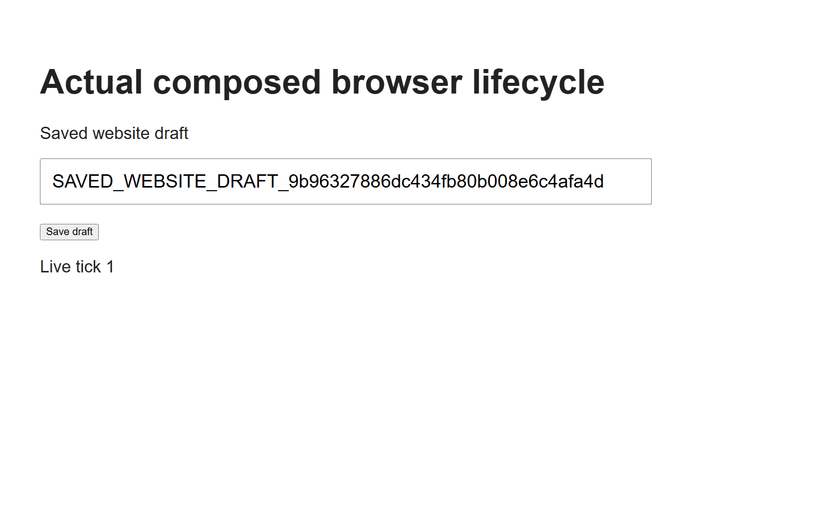

# Fresh companion two-machine proof

The combined disposable run passed in 117.8 seconds. It used actual Windows Electron 40.4.1 with Chromium 144.0.7559.173 and a fresh nonroot sandboxed Linux container running the installed plugin bin with bundled Chromium 153.0.8010.12. The installed agent and production data were not touched.

The native page and its saved login were synthetic. Actual existing cookie and vault hints started the real 60,000 ms backup timer. The encrypted upload began 60,506.3049 ms after timer creation. The mounted backend and PostgreSQL confirmed exactly one encrypted bundle, 1,867 ciphertext bytes and encrypted recipient envelopes, with no synthetic password or saved draft in plaintext. The same document, WebContents and ticking page stayed active. Profile authority and transition count did not change. No manual backup command or shorter timer was used.

The same run then approved and pinned the fresh agent endpoint, prepared its actual native browser inactive, closed the source through the normal Host/Supervisor path, and transferred an encrypted checkpoint through HOAI. The agent's durable encrypted journal was observed before its actual staged HTTP request. Fresh server activation preceded native activation. Native cookie and encrypted saved-login readback matched. A signed typed status RPC went through the actual plugin bin. Status is a protocol action, not website input.

Normal daemon EOF then committed a stopped checkpoint and exited 0. The source had zero remaining WebContents. The agent had zero owned browser processes, stopped its tracked private keyring and D-Bus, and a successful exact Docker inventory confirmed the container absent with no forced stop. All 166 captured non-test native source files were unchanged across the run.

The JSON records exact source/archive hashes, native observer/runtime/cookie qualifications, public receipts and explicit fixture boundaries. Native approval decisions and the external human JWT verifier are synthetic. The real key helpers, libsecret persistent collection ownership, native browsers, DPAPI, mounted HOAI APIs, pairing checks, signed endpoint proofs, SQL and encrypted files are actual.

This baseline proves native cookie readback and encrypted storage. The later approved-navigation result is recorded separately below. Delivery of restored cookies on a later HTTP request remains a separate claim. The source screenshots below show the synthetic page changing; they are source-native images, not a claim that the Linux page was streamed to a desktop.

A separate final run passed in 66.895 seconds against immutable plugin b948d6a. The native owner dialog reviewed https://example.com for the shared recipient and chose Allow once through the synthetic native decision fixture. The actual paired permission client verified and consumed that one permission through HOAI, the real browser returned Example Domain, and the completed command's permission read correctly returned 403. Normal EOF again exited 0 with no owned browsers or source WebContents, both private services stopped, and positive Docker absence without forced cleanup. Imported-cookie delivery to a website is still not claimed.

The broad source wrapper captured 167 files and reported false because another worker edited only dev/native-profile-parity.cjs during this run. That independent dev probe is not imported or executed by this fixture; the literal import/name scan found only its own references. All other 166 captured files, including every executed fixture and product source, were unchanged. The JSON preserves both hashes of the exception and the narrower result instead of claiming a blanket freeze. The independent reviewer closed these navigation, one-use permission and positive cleanup claims.
